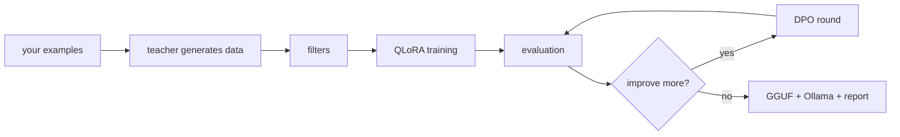

# touster

Fine-tune a small language model for one task, using a big model as the teacher. One notebook, runs on a free Colab T4.

[](https://colab.research.google.com/github/Patan-Sameer66/touster/blob/main/touster.ipynb)

## What it does

You write 20-50 examples of your task. touster then:

1. asks a teacher model (OpenAI, Gemini, Claude, a local Ollama model, or anything else [LiteLLM](https://docs.litellm.ai/docs/providers) supports) to write a few thousand more,
2. filters out duplicates, weak examples and anything that overlaps your test examples,
3. fine-tunes a 1-3B student model with QLoRA,
4. scores it against the untouched base model,
5. optionally improves it further with DPO rounds,
6. exports it to GGUF with an Ollama `Modelfile`, and writes an HTML report.



<!-- Dashboard GIF goes here: record the live dashboard during a run, save it as docs/dashboard.gif and add  -->

## Quickstart (Colab)

1. Click **Open in Colab**, then *Runtime > Change runtime type > T4 GPU*.
2. Add your teacher's API key in Colab Secrets (key icon on the left), e.g. `OPENAI_API_KEY` or `GEMINI_API_KEY`.
3. In cell 1, set `teacher_model` (e.g. `"gpt-4o-mini"`). The default task is a sentiment classifier trained on `examples/golden_sample.jsonl`.
4. *Runtime > Run all*. The first run installs packages and may ask you to restart the runtime once; then run all again.
5. Cell 3 shows the estimated cost and time and waits for you to type `y`.

When it finishes, `runs/<run_id>/report.html` has the results and the model is ready for Ollama:

```bash
ollama create my-model -f runs/<run_id>/export/Modelfile
```

Set `"smoke_test": True` in cell 1 first if you want a quick end-to-end check (tiny model, about 15 minutes).

## Your own task

Make a JSONL file with one example per line and point `golden_path` at it:

```json
{"id": "g-0001", "prompt": "The battery died after two days.", "response": "negative"}
```

Then set `task_name`, `task_description` (plain words, it goes into every teacher prompt) and `task_type`
(`classification`, `extraction`, `qa`, `code`, `summarisation` or `other`). About 30% of your examples guide
generation and training; the rest are kept aside for scoring only.

## Main settings

| Setting | Default | What it does |
|---------|---------|--------------|
| `teacher_model` | - | Model that writes training data (any LiteLLM id) |
| `student_model` | `unsloth/Qwen2.5-1.5B-Instruct` | Model you fine-tune |
| `target_examples` | `2000` | How many examples to generate |
| `max_usd` | `5.0` | Spending cap; the run stops cleanly when it is reached |
| `self_improve` | `true` | Run DPO rounds after the first training |
| `push_to_hub` / `hub_repo` | `false` | Upload the model (private repo) to Hugging Face |
| `run_dir` | `runs` | Output folder; on Colab use a Drive path to survive disconnects |

Every setting, with its limits, is in [`touster/config.py`](touster/config.py). A bad value stops cell 1 with a
message naming the field.

## Good to know

- **Resuming:** each cell saves its results. After a disconnect, run all again: finished cells are skipped and
  training continues from its last checkpoint. Set `FORCE = True` in a cell to redo it.
- **GPU:** cells 1-3 run on any computer; cells 4-7 need an NVIDIA GPU.
- **Running locally:** Linux, Python 3.11+, one CUDA GPU with 8 GB or more:
  `pip install -r requirements.txt jupyterlab==4.6.4 ipywidgets==8.1.9`, then open `touster.ipynb`.
- **Code tasks** run model-written code in a separate process without your API keys, but it is not a full
  sandbox. Use a throwaway Colab session for them.
- **Teacher terms:** many providers limit training other models on their outputs. Check yours before you
  publish a model trained this way.
- **Limits:** one task and one GPU per run, LoRA only. The LLM judge can be wrong; read the example answers in
  the report, not just the scores.

## Results

Default settings on the sentiment demo (to be filled in after a full run):

| Stage | Accuracy | Judge win rate vs base | Cost | Time |
|-------|----------|------------------------|------|------|
| base | - | - | - | - |
| fine-tuned | - | - | - | - |

## Troubleshooting

| Message | Fix |
|---------|-----|
| `Ollama is not reachable` | Start it with `ollama serve` and `ollama pull <model>` |
| `No price known for ...` | Add the model to `price_table`, or use `budget_mode="time"` |
| `SSL: CERTIFICATE_VERIFY_FAILED` | A proxy or antivirus is intercepting HTTPS; fix its certificate for Python |
| `already done, skipped` | Set `FORCE = True` in that cell |

## Contributing and licence

Tests: `pytest -q tests` (CPU only, no network). See [CONTRIBUTING.md](CONTRIBUTING.md). MIT licence, see [LICENSE](LICENSE).
